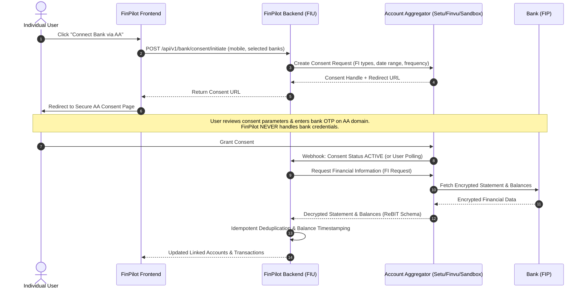

# Indian Account Aggregator (AA) Integration Architecture & Evaluation

## 1. Regulatory Framework & Standards

FinPilot AI connects to Indian banking data via the **Reserve Bank of India (RBI) Account Aggregator (AA)** framework (under *Master Direction - Non-Banking Financial Company - Account Aggregator (Reserve Bank) Directions, 2016*).

### Core Principles
1. **Consent-Driven**: Financial Data is accessed only with explicit, granular, time-bound electronic consent from the user.
2. **Zero Credential Sharing**: FinPilot AI **never** sees or stores user net banking passwords, ATM PINs, or bank SMS OTPs.
3. **Data Blindness**: The Account Aggregator merely routes encrypted Financial Information (FI) from the Financial Information Provider (FIP - Bank) to the Financial Information User (FIU - FinPilot).
4. **Revocability**: Users retain full statutory rights to revoke consent at any time.

---

## 2. Technical Provider Evaluation: Setu AA vs. Finvu AA

| Dimension | Setu AA (Pine Labs) | Finvu AA (Cookiejar Technologies) | FinPilot Assessment |
| :--- | :--- | :--- | :--- |
| **RBI License Status** | Operating as FIU & Tech Service Provider (TSP) via partner AAs | Licensed NBFC-AA (RBI registered) | Both support full ReBIT 1.1 / 2.0 API specifications. |
| **Sandbox & Dev Experience** | Instant self-serve developer portal, sandbox API keys, mock FIP simulator | Sandbox access upon partner sign-up, manual onboarding verification | **Setu** provides faster developer iteration; **Finvu** has direct native AA licensing. |
| **Supported FIPs (Banks)** | All major banks (HDFC, ICICI, SBI, Axis, Kotak, PNB, BoB, etc.) | All major public and private sector banks | Parity across both providers for standard Savings/Current (`DEPOSIT`). |
| **Supported FI Types** | `DEPOSIT`, `TERM_DEPOSIT`, `RECURRING_DEPOSIT`, `MUTUAL_FUNDS`, `EQUITY` | `DEPOSIT`, `TERM_DEPOSIT`, `MUTUAL_FUNDS`, `INSURANCE_POLICIES` | FinPilot v2.1 focuses on `DEPOSIT` (checking/savings) and `TERM_DEPOSIT` (FDs). |
| **Consent Modality** | Web Redirection / SDK Modal with Mobile OTP consent | Web Redirect flow to Finvu AA mobile app / web portal | Redirection flow chosen for web browser security without native SDK bloat. |
| **Data Fetch Frequency** | `PERIODIC` (Daily / Weekly) and `ONE_TIME` | `PERIODIC` and `ONE_TIME` | Configurable in consent request; periodic sync runs once daily; manual on-demand refresh throttled to prevent FIP rate-limiting. |
| **Balance Availability** | Current Available Balance provided at time of FI fetch | Available Balance provided at time of FI fetch | Neither provider guarantees millisecond-level live streaming; balances must be stored with explicit `balance_timestamp` and labeled as cached when > 2 hours old. |
| **Production Onboarding** | Requires registered Indian entity, FIU agreement, VAPT audit certificate, CERT-In compliance | Requires registered Indian entity, FIU-AA legal agreement, ReBIT technical audit | Requires formal enterprise legal contract before going live. Sandbox mode utilized until enterprise onboarding is complete. |

---

## 3. Account Aggregator Data Flow

---

## 4. Idempotency, Deduplication & Transfer Handling

1. **Transaction Deduplication**:
   - Each transaction received from the AA has a unique bank reference identifier (`txn_id` or `narration` + `date` + `amount` hash).
   - Compound constraint: `(bank_account_id, provider_txn_ref)`. Duplicate inserts are ignored silently, updating only the transaction status.
2. **Internal Transfer Detection**:
   - When a debit in Account A matches a credit in Account B (same user, identical amount within a ±24-hour window), it is flagged as `is_internal_transfer = True`.
   - Internal transfers are excluded from monthly budget expense totals and income summaries.
3. **Balance Staleness**:
   - `balance_timestamp`: The exact timestamp returned by the bank FIP.
   - UI display: Shows relative age ("Updated 15 mins ago"). If older than 24 hours, displays a "Stale" indicator with a "Refresh" CTA.
