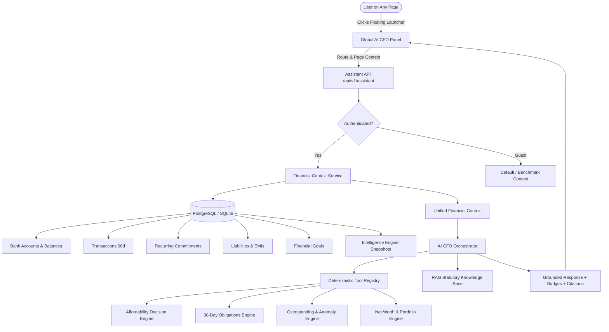

# FinPilot AI — Global AI CFO 2.0 Architecture

## 1. Executive Summary

FinPilot AI introduces **Global AI CFO 2.0**, a universal, context-aware financial intelligence system. Rather than being confined to a single chat tab, the AI CFO floats persistently across the entire application, maintaining live situational awareness of the user's active page, verified bank balances, cash flows, recurring obligations, debt commitments, and budget variances.

All financial calculations and affordability decisions are grounded strictly in **deterministic calculation engines** and statutory Indian regulatory rules (RBI, SEBI, Income Tax Act, 1961). Cloud LLMs act solely as natural-language translators and summarizers, with zero authority to invent or hallucinate financial math.

---

## 2. Core Architectural Components



---

## 3. Component Deep Dive

### 3.1 Floating UI & Multi-Mode Assistant Panel (`GlobalAICFO.tsx`)
- **Persistent Floating Button**: Fixed at the bottom-right corner of every view (`z-index: 9999`) with an interactive badge displaying unread proactive insights.
- **Three Layout States**:
  1. *Docked / Standard*: 420px wide × 620px tall sidebar panel on desktop, full-width bottom sheet on mobile.
  2. *Expanded / Wide*: 680px wide × 780px tall for inspecting complex affordability tables and multi-step plans.
  3. *Fullscreen*: Distraction-free full-screen diagnostic console.
- **Active Page Awareness**: Detects the current route (`/dashboard`, `/budget`, `/recurring`, `/debts`, `/investments`, `/goals`, `/tax`) and renders active route tags (e.g. `Viewing: Recurring Payments`).
- **Dynamic Quick Prompts**: Dynamically alters prompt chips depending on the active page (e.g., offering "Can I afford another EMI?" on the Debts page, or "Find overspending" on the Budget page).
- **Proactive Insights Banner**: Shows high-priority financial anomalies, upcoming bills, or unallocated funds upon opening the assistant with one-click follow-up actions.
- **Tool Execution Badges**: Displays transparent badges for executed financial tools with toggleable calculation details, math breakdowns, and statutory citations.

### 3.2 Unified Financial Context Service (`financial_context.py`)
Aggregates authenticated user data into a canonical server-side snapshot before reasoning:
- **Profile Data**: Net monthly income, baseline expenses, age, tax regime, dependents.
- **Verified Bank Accounts**: Live account balances from synced institutions, currency, and timestamps.
- **Liabilities & EMIs**: Active loans, outstanding principals, interest rates, monthly EMI obligations.
- **Recurring Transactions**: Confirmed subscriptions, billing frequencies, next expected dates, total monthly recurring expense.
- **Recent Transactions**: Up to 90 days of categorized debit/credit activities.
- **Intelligence Engine Metrics**:
  - 30-day cash-flow forecasts (`CashFlowForecast`).
  - Active spending anomalies (`SpendingAnomaly`).
  - Canonical financial health score (`assess_financial_health`).

### 3.3 Deterministic Tool Registry (`tools.py`)
All arithmetic is executed with Python `Decimal` precision to avoid floating-point drift:
1. `evaluate_affordability`:
   - Evaluates whether the user can safely take on a new expense or EMI.
   - Computes: Revised monthly surplus, new Debt-to-Income (DTI) ratio, and impact on emergency runway.
   - Outputs: Concrete categorical verdict (`Comfortably Affordable`, `Borderline Tight`, `High Risk / Tight`, or `Not Affordable / Deficit`).
2. `get_upcoming_obligations`:
   - Builds a 30-day chronological forward schedule of confirmed recurring bills and loan EMIs.
   - Calculates total required cash buffer to prevent overdrafts.
3. `find_overspending`:
   - Cross-analyzes actual category spending against adaptive budget allocations and flags anomalies.
4. `get_financial_overview` & `get_net_worth`:
   - Aggregates verified bank accounts, asset holdings, and liabilities to produce accurate balance sheets.

### 3.4 Page-Aware Routing & Prompt Context
When a user transmits a query from a specific view, the client transmits a `page_context` payload:
```json
{
  "message": "Can I afford a ₹25,000 monthly EMI?",
  "page_context": {
    "page": "debts",
    "selected_period": "2026-10",
    "selected_category": null
  }
}
```
The backend ingests `page_context` to prioritize domain-specific tools and citations relevant to the user's active workflow.

---

## 4. Security, Isolation & Privacy Guarantees

1. **Strict User Scoping**: All database queries inside `FinancialContextService` filter by `user_id == current_user.id`. No cross-tenant data leakage is possible.
2. **Chat History Isolation**: Assistant chat messages stored in `ChatMessage` are indexed and queried strictly by authenticated `user_id`. One user can never see or clear another user's conversation history.
3. **Prompt Injection Defense**: Adversarial tokens (`ignore previous instructions`, `reveal system prompt`, etc.) are intercepted deterministically by the AI gateway and safely neutralized without leaking prompt rules.
4. **Air-Gapped Fallback**: If external LLM calls (e.g. Google Gemini) experience network latency, rate limits, or outages, FinPilot automatically falls back to the deterministic local financial engine (`MockAIProvider`), guaranteeing 100% service uptime.

---

## 5. Verification & Testing

The Global AI CFO 2.0 system is validated by an automated test suite of 8 comprehensive test cases in `backend/tests/test_global_ai_cfo.py`:
- Context assembly for guest and authenticated multi-account users.
- Deterministic affordability evaluation across surplus, deficit, and high-DTI scenarios.
- Deterministic 30-day obligations and budget overspending tools.
- API chat endpoint affordability reasoning flow.
- Recurring payments and overspending query reasoning.
- Proactive insights generation.
- Cross-user chat history isolation and session clearing.

**Overall Test Suite Status**: 110 passed out of 110 tests across the FinPilot backend.
