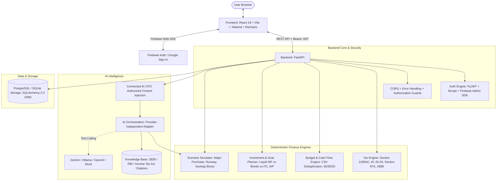

# FinPilot AI — Architecture & Design

## 1. System Overview

FinPilot AI is an explainable personal finance platform tailored for Indian individuals and small-business owners.
The system strictly separates **deterministic financial computations** (Tax, Budget, Investment projections, Decision Scenarios) from **generative AI/LLM components** (Assistant, Explainability, RAG) to guarantee mathematical accuracy, regulatory compliance, and zero hallucination of monetary numbers.

## 2. Core Architectural Pillars

### A. Dual Authentication & Identity Strategy
- **Client Side**: Supports both traditional Email/Password and Google Sign-In via Firebase Web SDK.
- **Server Side**: Firebase Admin SDK validates token signature, issuer, audience, and expiry (`firebase_admin.auth.verify_id_token`).
- **Internal Mapping**: Verified Firebase UID maps directly to an internal FinPilot `User` record (`firebase_uid`, `auth_provider`).
- **Explicit Account Linking Protection**: If a Google account's email matches an existing local email/password account, the system **never auto-merges blindly**. It returns `409 Conflict`, requiring explicit password authentication before linking the identities (`auth_provider = 'linked'`).

### B. Deterministic Financial Decision Simulator
- Operates on validated Pydantic schemas without model hallucination.
- Evaluates **Major Purchases** (e.g., ₹8L-15L car purchase across 18-36 months) with 3 concrete strategic options:
  1. *Prudent Down Payment + Auto Loan*: Preserves essential 3-month emergency runway, invests monthly surplus in Liquid Mutual Funds, and structures auto loan debt within RBI recommended limits (EMI <= 15% net income).
  2. *Extended Timeline All-Cash Purchase*: Calculates debt-free horizon to accumulate 100% purchase cost without interest charges.
  3. *Discretionary Lifestyle Compression*: Rebalances 50/30/20 non-essential spending by 20% to accelerate capital accumulation.
- Saves scenarios securely to `ScenarioRecord` linked to the authenticated user.

### C. Connected AI CFO Pipeline
- **Context Injection**: Reads authenticated user financial profile (net income, living expenses, liquid savings) without sending unnecessary PII to external models.
- **Deterministic Tool Calling**: Invokes `simulate_major_purchase`, `calculate_tax`, `compare_investments`, and `analyze_budget`.
- **RAG Regulatory Grounding**: Indexes and cites official statutory sources (SEBI Circulars on Liquid Funds, DICGC Act for deposit safety, Income Tax Act AY 2025-26 revisions).
- **Graceful Offline Mode**: `MockAIProvider` provides instant, deterministic, zero-cost intelligence when external LLM API keys are omitted.

### D. Data Isolation & Authorization
- Every private endpoint extracts `current_user` strictly from the verified JWT Bearer token.
- Cross-user data access is structurally impossible: queries filter strictly on `user_id == current_user.id`.
- Model parameters cannot override or forge user identity.
