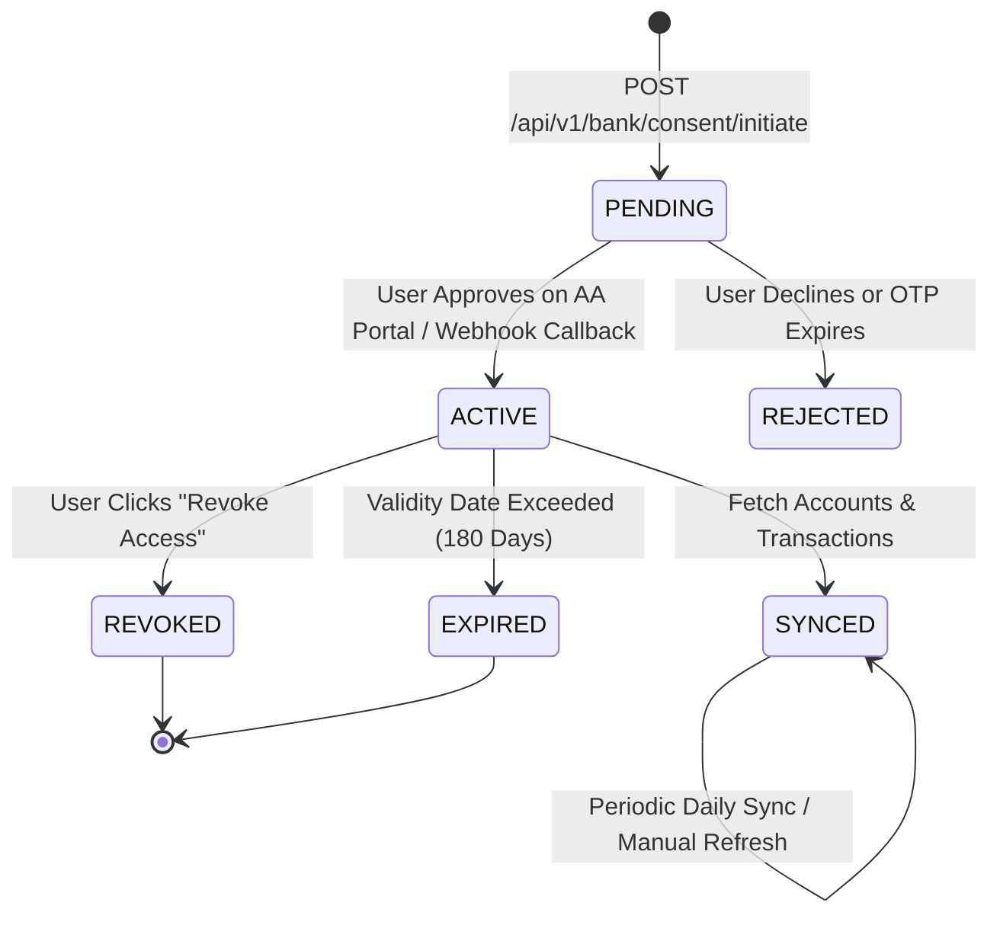

# FinPilot AI — Indian Bank Integration & Account Aggregator Guide

## 1. Overview & Architecture

FinPilot AI v2.1 integrates with Indian banking institutions exclusively through the **Reserve Bank of India (RBI) Account Aggregator (AA)** framework.

### Security Guarantees
- **No Credentials Stored**: FinPilot never captures, stores, or handles user net banking passwords, debit card PINs, or bank OTPs.
- **Explicit Electronic Consent**: Financial Information (FI) is only retrieved when authorized by explicit, time-bound, customer-approved consent artifacts.
- **Data Blindness**: The Account Aggregator operates as a data-blind pipe, routing encrypted statements between the bank (Financial Information Provider - FIP) and FinPilot (Financial Information User - FIU).
- **Statutory Revocability**: Under RBI guidelines and the **Digital Personal Data Protection (DPDP) Act, 2023**, users retain irrevocable rights to revoke consent and permanently purge synchronized financial statements.

---

## 2. Supported Providers & Configuration

### A. Sandbox Mode (Default - Zero External Dependencies)
By default, FinPilot operates in deterministic Sandbox Mode. This allows local development and automated testing with realistic Indian banks (HDFC, ICICI, SBI, Axis), masked accounts, and ReBIT-compliant transaction feeds.

In `.env`:
```env
BANK_PROVIDER=sandbox
```

### B. Live Setu Account Aggregator (Pine Labs)
To connect to live or sandbox Setu Account Aggregator:
1. Register an account on [Setu Bridge](https://bridge.setu.co/).
2. Create an Account Aggregator application and note your API keys.
3. Update `.env`:
```env
BANK_PROVIDER=setu
BANK_SETU_CLIENT_ID=your_setu_client_id
BANK_SETU_CLIENT_SECRET=your_setu_client_secret
BANK_SETU_PRODUCT_INSTANCE_ID=your_product_instance_id
BANK_WEBHOOK_SECRET=your_webhook_signature_secret
```

### C. Live Finvu Account Aggregator (Cookiejar Technologies)
1. Complete institutional FIU onboarding with [Finvu AA](https://finvu.in).
2. Configure credentials:
```env
BANK_PROVIDER=finvu
BANK_FINVU_CLIENT_ID=your_finvu_client_id
BANK_FINVU_CLIENT_SECRET=your_finvu_client_secret
```

---

## 3. Account Aggregator Consent Lifecycle



### API Endpoints
| Endpoint | Method | Description |
| :--- | :---: | :--- |
| `/api/v1/bank/consent/initiate` | `POST` | Initiates consent session with mobile number and selected FIPs. |
| `/api/v1/bank/consent/{id}` | `GET` | Returns status of consent (`PENDING`, `ACTIVE`, `REVOKED`, `EXPIRED`). |
| `/api/v1/bank/consent/{id}/approve` | `POST` | Approves consent in sandbox and discovers accounts. |
| `/api/v1/bank/consent/{id}/revoke` | `POST` | Revokes consent and marks linked accounts as stale. |
| `/api/v1/bank/accounts` | `GET` | Lists all linked accounts for authenticated user. |
| `/api/v1/bank/accounts/{id}/sync` | `POST` | Manually triggers transaction sync and balance refresh. |
| `/api/v1/bank/logs` | `GET` | Returns synchronization audit logs. |

---

## 4. Idempotency & Deduplication Engine

To prevent duplicate transactions on network retries or daily syncs:
1. **Provider Reference Keying**: Each transaction receives a unique `provider_txn_ref` (e.g. `TXN_HDFC_202610_001`).
2. **Database Constraint**: `transactions` table enforces a unique index on `provider_txn_ref`.
3. **Internal Transfer Detection**:
   When a debit in Account A matches a credit in Account B (same user, identical amount within a ±24-hour window), FinPilot sets `is_internal_transfer = True`.
   Internal transfers are excluded from monthly living expense totals to avoid double-counting.

---

## 5. Production Enterprise Onboarding Checklist

Before requesting live production bank access from Setu or Finvu:
- [ ] Registered Indian corporate entity (Pvt Ltd or LLP).
- [ ] Sign FIU-AA agreement with licensed NBFC-AA.
- [ ] CERT-In empaneled security audit (VAPT certificate).
- [ ] ReBIT API compliance validation.
- [ ] DPDP Act 2023 privacy policy and consent manager disclosure.
