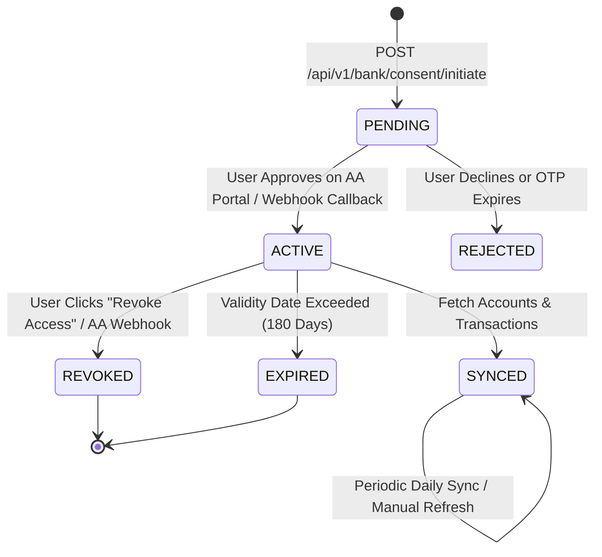

# FinPilot AI — Indian Bank Integration & Account Aggregator Guide

## 1. Overview & Architecture

FinPilot AI v2.1 integrates with Indian banking institutions exclusively through the **Reserve Bank of India (RBI) Account Aggregator (AA)** framework.

### Security Guarantees
- **No Credentials Stored**: FinPilot never captures, stores, or handles user net banking passwords, debit card PINs, or bank OTPs.
- **Explicit Electronic Consent**: Financial Information (FI) is only retrieved when authorized by explicit, time-bound, customer-approved consent artifacts.
- **Data Blindness**: The Account Aggregator operates as a data-blind pipe, routing encrypted statements between the bank (Financial Information Provider - FIP) and FinPilot (Financial Information User - FIU).
- **Statutory Revocability**: Under RBI guidelines and the **Digital Personal Data Protection (DPDP) Act, 2023**, users retain irrevocable rights to revoke consent and permanently purge synchronized financial statements.

---

## 2. Supported Providers & Configuration

### A. Live Finvu Account Aggregator (Cookiejar Technologies - Primary Provider)
FinPilot integrates with Finvu under the **Hosted FIU Gateway model**.

1. Obtain FIU credentials from the [Finvu Developer Portal](https://finvu.in).
2. Configure environment variables in `backend/.env`:
```env
BANK_PROVIDER=finvu
BANK_FINVU_CLIENT_ID=your_finvu_client_id
BANK_FINVU_CLIENT_SECRET=your_finvu_client_secret
BANK_FINVU_BASE_URL=https://fiu-uat.finvu.in
BANK_FINVU_FIU_ID=finpilot-fiu
BANK_FINVU_WEB_URL=https://web-uat.finvu.in
BANK_FINVU_PUBLIC_KEY=optional_finvu_rsa_public_key_pem
BANK_WEBHOOK_SECRET=your_webhook_signature_secret_or_hmac_key
BANK_REDIRECT_URL=https://confidingly-ketonic-evelina.ngrok-free.dev/bank/consent/callback
```
3. **Provider Dashboard Configuration**:
   In your Finvu Developer Portal / FIU Settings, register the following exact URLs:
   - **Browser Redirect URL (Frontend Consent Return)**:
     - Development: `https://confidingly-ketonic-evelina.ngrok-free.dev/bank/consent/callback`
     - Production: `https://<your-domain>/bank/consent/callback`
   - **Server-to-Server Webhook URLs (ReBIT 2.0 Standard)**:
     - Consent Notifications: `POST https://<api-domain>/api/v1/bank/Consent/Notification`
     - FI Data Notifications: `POST https://<api-domain>/api/v1/bank/FI/Notification`
     - Unified Webhook Endpoint: `POST https://<api-domain>/api/v1/bank/webhook`

### B. Sandbox Mode (Zero External Dependencies)
Operates in deterministic Sandbox Mode for offline development and local automated testing with simulated Indian banks:
```env
BANK_PROVIDER=sandbox
```

### C. Setu Account Aggregator (Optional Legacy / Secondary Adapter)
Setu is preserved as an optional alternative adapter:
```env
BANK_PROVIDER=setu
BANK_SETU_CLIENT_ID=your_setu_client_id
BANK_SETU_CLIENT_SECRET=your_setu_client_secret
BANK_SETU_PRODUCT_INSTANCE_ID=your_product_instance_id
BANK_WEBHOOK_SECRET=your_webhook_signature_secret
```

---

## 3. Account Aggregator Consent Lifecycle & Webhook Architecture



### API Endpoints
| Endpoint | Method | Authentication | Description |
| :--- | :---: | :---: | :--- |
| `/api/v1/bank/consent/initiate` | `POST` | User Bearer | Initiates consent session with mobile number and selected FIPs; returns `redirect_url`. |
| `/api/v1/bank/consent/callback` | `POST` | User Bearer | Client browser redirect handler; verifies state against provider adapter and links accounts. |
| `/api/v1/bank/consent/by-handle/{handle}` | `GET` | User Bearer | Fetches consent status by `consent_handle`. |
| `/api/v1/bank/Consent/Notification` | `POST` | `x-jws-signature` / Webhook Secret | Canonical ReBIT 2.0 server-to-server webhook for consent lifecycle events (`ACTIVE`, `REVOKED`, `REJECTED`). |
| `/api/v1/bank/FI/Notification` | `POST` | `x-jws-signature` / Webhook Secret | Canonical ReBIT 2.0 server-to-server webhook for FI data session readiness (`COMPLETED`, `READY`). |
| `/api/v1/bank/webhook` | `POST` | `x-jws-signature` / Webhook Secret | Unified webhook endpoint for dashboards requiring a single notification URL. |
| `/api/v1/bank/consent/{id}` | `GET` | User Bearer | Returns status of consent (`PENDING`, `ACTIVE`, `REVOKED`, `EXPIRED`). |
| `/api/v1/bank/consent/{id}/approve` | `POST` | User Bearer | Approves consent in sandbox and discovers accounts. |
| `/api/v1/bank/consent/{id}/revoke` | `POST` | User Bearer | Revokes consent and marks linked accounts as stale. |
| `/api/v1/bank/accounts` | `GET` | User Bearer | Lists all linked accounts for authenticated user. |
| `/api/v1/bank/accounts/{id}/sync` | `POST` | User Bearer | Manually triggers transaction sync and balance refresh. |
| `/api/v1/bank/logs` | `GET` | User Bearer | Returns synchronization audit logs. |

---

## 4. Idempotency & Deduplication Engine

To prevent duplicate transactions on network retries or daily syncs:
1. **Provider Reference Keying**: Each transaction receives a unique `provider_txn_ref` (e.g. `TXN_HDFC_202610_001`).
2. **Database Constraint**: `transactions` table enforces a unique index on `provider_txn_ref`.
3. **Internal Transfer Detection**:
   When a debit in Account A matches a credit in Account B (same user, identical amount within a ±24-hour window), FinPilot sets `is_internal_transfer = True`.
   Internal transfers are excluded from monthly living expense totals to avoid double-counting.

---

## 5. Production Enterprise Onboarding Checklist

Before requesting live production bank access from Setu or Finvu:
- [ ] Registered Indian corporate entity (Pvt Ltd or LLP).
- [ ] Sign FIU-AA agreement with licensed NBFC-AA.
- [ ] CERT-In empaneled security audit (VAPT certificate).
- [ ] ReBIT API compliance validation.
- [ ] DPDP Act 2023 privacy policy and consent manager disclosure.
