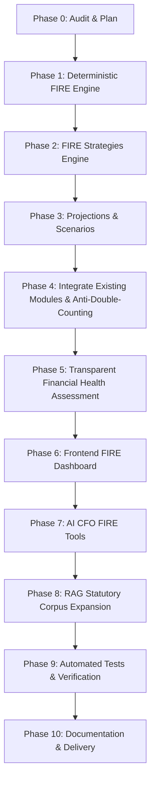

# FinPilot AI v2.2 — FIRE Forecasting & Comprehensive Financial Planning Implementation Plan

## 1. Executive Summary & Audit Baseline

- **Repository**: `d:\finpilot`
- **Initial Baseline Commit**: `91ab34f`
- **Test Baseline**: 60 passed out of 60 tests (100%) in `backend/tests/`.
- **Frontend Build Baseline**: `npm run build` succeeds cleanly with zero errors in ~4.5 seconds.
- **Architecture**:
  - Backend: FastAPI, SQLAlchemy 2.x, Pydantic v2, Python 3.14.
  - Frontend: React 18, TypeScript, Vite, Tailwind CSS, Recharts, Lucide React.
  - Database: SQLite (local development) / PostgreSQL (production), managed via Alembic.
  - Authentication: Firebase Authentication & backend token validation with dev mode support.
  - AI Engine: Cloud-only Google Gemini (`gemini-2.5-flash`) via `google-genai` SDK + RAG hybrid search.
  - Bank Connectivity: RBI Account Aggregator framework (Sandbox, Setu, Finvu).

---

## 2. Audit Findings & Gap Analysis

### Current Capabilities & Reusable Assets
1. **Financial Profiles & Models** (`backend/app/models/financial.py`):
   - `FinancialProfile`: age, dependents, monthly_income, monthly_expenses, risk_tolerance, emergency_fund_target_months.
   - `AssetHolding`: categorizes liquid funds, fixed deposits, sovereign bonds, equity mutual funds, EPF/PPF, gold, real estate, cash with current value and expected returns.
   - `Liability`: principal, interest rate, tenure, remaining months, and monthly EMI.
   - `FinancialGoal`: target amount, current amount, target date, priority.
   - `Transaction`: bank account linking, deduplication (`provider_txn_ref`), internal transfer isolation.
   - `BankAccount`: verified bank balances with timestamps and freshness status.
2. **Deterministic Calculation Engines** (`backend/app/finance/`):
   - `BudgetEngine`: Cash flow, savings rate, emergency runway, 50-30-20 rule, debt avalanche vs snowball.
   - `InvestmentEngine`: Compound interest, goal projection, liquid vs bond vs FD comparison.
   - `ScenarioEngine`: Decision simulator, multi-variable parameter modeling.
   - `IndianTaxEngine`: Finance Act 2024 slabs, Sections 115BAC, 87A rebate, standard deductions.

### Gaps Addressed in v2.2
1. **No Dedicated FIRE Engine**: Currently lacks algorithms for:
   - SWR (Safe Withdrawal Rate) targets in Indian context (3.0% to 4.5% based on inflation and longevity).
   - Inflation-adjusted retirement target ($FV = PV \times (1 + i)^n$).
   - Multiple FIRE strategies (Lean FIRE, Regular FIRE, Fat FIRE, Coast FIRE, Custom FIRE).
   - Net worth vs. investable retirement assets isolation (excluding illiquid primary residence).
   - Required monthly SIP to bridge retirement portfolio shortfall.
   - Year-by-year portfolio accumulation and post-retirement decumulation modeling under conservative, base, and optimistic return profiles.
2. **Financial Health Assessment**: No unified, transparent rule-based score combining emergency runway, debt-to-income, savings rate, investment allocation, goal funding, and retirement readiness.
3. **AI CFO Tools**: Assistant has no backend tools to answer FIRE queries (e.g., "When can I retire?", "What if I invest ₹10,000 more per month?", "Can I Coast FIRE?").
4. **Statutory Retirement Knowledge in RAG**: Corpus lacks statutory guidance on retirement corpus taxation (EPF/NPS exemptions, Section 112A capital gains, Section 80TTB interest deduction for senior citizens).
5. **Frontend View**: No dedicated FIRE forecasting view with scenario comparison and interactive controls.

---

## 3. Implementation Sequence & Architecture

### Planned Files:
1. `backend/app/schemas/fire.py`: Pydantic models for FIRE inputs, strategies, health score, and projections.
2. `backend/app/finance/fire/engine.py`: Deterministic FIRE calculations, formulas, and strategies.
3. `backend/app/finance/fire/health.py`: Transparent 8-pillar financial health scoring with 12-month priority plan.
4. `backend/app/api/v1/endpoints/fire.py`: REST endpoints for calculation, user profile retrieval, projections, and health assessment.
5. `backend/app/ai/tools.py`: Add FIRE and financial health tools to `FinancialToolsRegistry`.
6. `backend/app/rag/corpus.py`: Add Indian retirement statutory knowledge (NPS, EPF, LTCG, senior tax benefits).
7. `frontend/src/features/fire/FirePlanningView.tsx`: Premium light fintech UI for FIRE forecasting.
8. `frontend/src/components/Sidebar.tsx` & `App.tsx`: Add `'fire'` route.
9. `backend/tests/test_fire_engine.py`: Comprehensive test suite for FIRE calculations and edge cases.
10. `docs/FIRE_METHODOLOGY.md`: Detailed financial formulas and disclosures.
