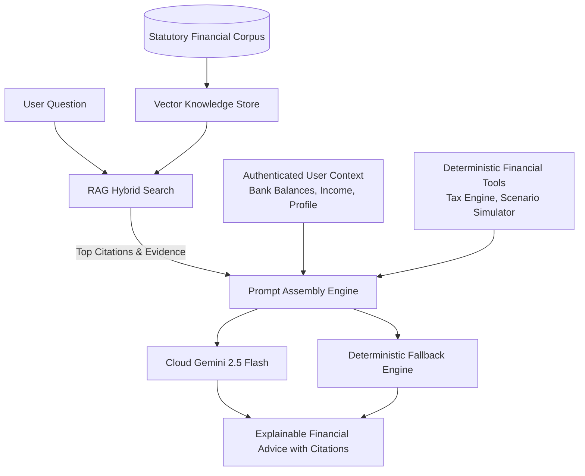

# FinPilot AI — Retrieval-Augmented Generation (RAG) Architecture & Setup

## 1. Principles of Financial RAG

FinPilot AI applies **Retrieval-Augmented Generation (RAG)** strictly to grounded, verifiable statutory documents.

### Critical Rules
1. **Never Hallucinate Math**: Arithmetic, tax liabilities, and compound interest calculations are computed deterministically via specialized financial engines—never generated by the language model.
2. **Statutory Ground Truth**: RAG indexes official publications from the **Income Tax Department**, **Finance Act 2024**, **RBI**, and **SEBI**.
3. **Data Isolation**: Private user transaction histories, bank balances, and profile details are **never** placed into the shared vector store. User financial context is injected dynamically at runtime scoped strictly to the authenticated user's session.
4. **Prompt Injection Defense**: All ingested documents and user prompts are passed through sanitizers to strip prompt injection phrases (`ignore previous instructions`, `system prompt`, `<script>`).

---

## 2. Architecture & Vector Store



---

## 3. Configuration & Providers

### A. Cloud Gemini LLM & Embeddings (Recommended for Production)
FinPilot uses Google Gemini 2.5 Flash for conversational reasoning and `text-embedding-004` (768 dimensions) for semantic retrieval.

In `.env`:
```env
LLM_PROVIDER=gemini
LLM_API_KEY=your_gemini_api_key_here
LLM_MODEL=gemini-2.5-flash
LLM_TIMEOUT_SECONDS=15.0
```

### B. Offline Deterministic Mode (Default)
When no Gemini API key is provided, FinPilot operates seamlessly with its deterministic planning engine and 768-dimensional normalized feature-hash embeddings:
```env
LLM_PROVIDER=mock
```
All unit tests and offline workflows pass 100% without external API calls or network connectivity.

---

## 4. Ingested Statutory Corpus

The knowledge base in `app/rag/corpus.py` includes:
- **Finance (No. 2) Act 2024 / Section 115BAC**: AY 2025-26 New Regime slabs, ₹75,000 standard deduction, Section 87A ₹7,00,000 rebate.
- **Income-tax Act 1961 Chapter VI-A**: Sections 80C, 80D, 80CCD(1B), 24(b) home loan interest, 10(13A) HRA exemption.
- **Section 44ADA**: Presumptive taxation scheme for professionals and freelancers up to ₹75 Lakh receipts.
- **Sections 112A & 111A**: Capital gains tax on listed equity (12.5% LTCG with ₹1.25 Lakh exemption, 20% STCG).
- **SEBI Circulars**: Liquid Mutual Fund 91-day maturity, 20% liquid asset norms, instant redemption up to ₹50,000/90%.
- **DICGC Act 1961**: ₹5,00,000 bank deposit insurance cover per depositor per bank.
- **RBI Master Directions on Account Aggregators**: Consent architecture, data blindness, zero credential storage.

---

## 5. Verification & Testing

Run the dedicated RAG test suite:
```bash
python -m pytest backend/tests/test_rag_system.py -v
```
All 7 tests verify semantic retrieval, topic filtering, relevance thresholds, prompt injection sanitization, and citation completeness.
